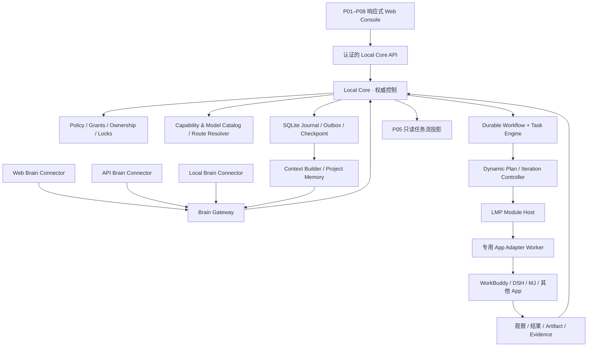

# ARCH-06-01｜Local Agent Hub 统一总体架构 V0.1

**状态：RECOMMENDED / REVIEW DRAFT；适用：Windows 本机单用户、桌面优先的响应式 Web Console。**

## 1. 产品边界与目标

Local Agent Hub 是独立运行的 Windows 本机多 AI / 多 App 协作编排平台。用户可以在 Hub 页面或已绑定的 Brain 会话中提出目标；Brain 生成结构化候选任务；Core 在能力、版本、会话、权限、预算、资源锁和证据约束下执行；Module Host/Adapter 将任务落实到具体 App（WorkBuddy、DSH、MJ、网页/本机/API 服务等），随后记录证据、验证结果、交付结果并决定下一轮。

**Relay 不是产品的一部分**：现存 Relay 仅用于开发过程中的 GPT ↔ WorkBuddy 辅助自动化，不继承其业务协议、数据库、调度模型和安全决策。

**不是首版目标**：云端多用户/跨电脑平台；未经验证的任意网页自动化；无需批准的任意 Shell；开放不可信插件市场；强 Windows OS 沙箱；端到端 exactly-once 外部操作；不限制资源/费用的自主调用。

## 2. 一张总架构图

图中箭头是职责依赖图，不授予跨边界权限；任何 Hub 受管执行都必须通过 Core。Webflow 原型不能被认定为真实控制后台。

## 3. 责任划分表（防止重复建设）

| 组件 | 权责 | 不负责 |
|---|---|---|
| Web Console | 用户查看、草稿、配置、正式确认 | 不直接持有权威任务状态或高权限凭据 |
| Brain Gateway | 可信 Connector 进入 Core 的任务提案入口、结果交付适配 | 不审批自身提案、不代替 Core 授权 |
| Brain Session Manager | 逻辑 Brain 会话、主/备用规划者、Epoch、交接 | 不成为外部 App 会话写入 Owner 的替代品 |
| Model Catalog/Router | 枚举已验证选项；按能力、授权、免费优先及预算筛选 | 不宣称网页 UI 选项等于实际后端模型 |
| Workflow + Task Engine | Revision、Run、NodeExecution、Task、Attempt、队列、调度 | 不创建第二套 Relay 状态机 |
| Iteration Controller | 控制跨轮次的规划→执行→验证→复盘 | 不能以“新一轮”绕过未知副作用和人接管阻断 |
| Policy/Ownership | LOCAL_READ、EXTERNAL_DISCLOSURE、LOCAL_EXECUTE；session fencing；锁 | 不能物理阻止共享 Windows 用户权限的所有外部程序 |
| Module Registry/Host | 导入可信包、Manifest、Worker 生命周期、握手、协议消息 | 不自行裁决工作流整体成功 |
| 专用 Adapter | 每个 App 单独识别 UI/API/ACP；模型配置和外部证据 | 不直接写 Core 的权威状态 |
| Journal / Artifact / Memory | 不可变事件、派发事实、结果证据、候选记忆与检查点 | 不把 AI 摘要当独立业务验证 |
| Task Monitor | 以 Core Journal 事实为依据可视化进度 | 不根据动画或超时猜测外部成功 |

## 4. 三种任务入口，一种执行底座

### 4.1 Direct Task
“读取获授权的项目状态”。Connector 提交 Proposal；Core 校验并登记 Run/Task 等权威身份；可走单节点模板；通过 LMP 派发；结果单独持久化、交付、验证。**不存在直通 Adapter 的快捷后门**。

### 4.2 Workflow Draft
“GPT → MJ → Vision → Review”。Brain 从 Capability Registry 查询真正存在的能力/模型/连接，生成可编辑草稿；用户审核并发布不可变 Revision；Core 按 Revision 执行。

### 4.3 Autonomous Workflow
“持续开发直到验证通过”。发布外层固定 Revision（包括可用能力范围、授权预算/模型池/资源范围/完成条件）；每轮 Brain 提交 Dynamic Plan；Core 校验形成新的可追溯 NodeExecution/Task/Attempt；不改写已启动 Revision。

## 5. 模块如何自由连线

- 模块 Package、Runtime、Endpoint、Connection、Session Binding、Workflow Node 是不同实体。
- 能力接口来自版本化 `Capability Descriptor`，已有 `inputSchema/outputSchema/sideEffectClass/retrySafety/concurrencyScope/requiredGrants/evidenceContract`。
- Workflow 层增加 `Port` 与 `EdgeMapping`：**控制依赖边**与**数据传输边**必须区别表示；所有数据边都经 Scope/Schema/Disclosure 校验。
- 单个 Adapter 可声明 Agent/Tool/Application/Media 多个能力类别；**执行端类别不是另一个 LMP**。
- App 专用 Driver 单独实现外部页面或 API，Core 不内置“MJ 特殊调度规则”；支持能力发现与实际可用性检查。
- 模型切换可能按请求、会话或 App 全局生效；全局设置需额外锁，无法证实生效则降低保障或阻断。

## 6. Planner、模型与验证的协作

- Brain Role ≠ Provider/Model：Planner、Reviewer、Verifier 均是节点角色；API 模型、网页模型和本地模型是实现来源。
- 用户选择已确认方案 B：在**授权模型池内**自主选择，任务能力满足后免费优先；有付费上限，不能因模型“更强”而绕过许可。
- 核验优先：确定性 Test Profile/文件事实 > AI 语义判断；AI 的“完成”不自动成为业务验收。
- 关键策略对象：`ModelSelectionPolicy`、`BrainSession`、`BrainOwnershipEpoch`、`AutonomyPolicy`，均为候选领域对象而非已冻结 LMP 字段。

## 7. 长期任务与恢复

- 没有固定总轮数可以接受；预算、执行权限、停滞监测、频率限制、上下文披露范围、完成条件始终有效。
- Journal 以持久化序号为权威顺序；事务型 Outbox 保存派发意图；大文件用 ArtifactRefs；Checkpoint 是 Journal 投影而不是唯一事实源。
- 恢复时区分：尚未派发、可能已外部提交、已确认在执行、结果已保存未交付、外部结果未知。后者必须对账，不能自动重执行。
- `RecoveryCheckpoint` 用于服务重启；`HandoffSafeCheckpoint` 用于 Brain 交接，二者不等同。
- 主 Brain 故障时只切换已授权且满足 Disclosure/模型策略的 API Brain；原 Brain 恢复后仅在可验证会话和安全检查点、经交接确认后尝试切回；未能验证网页收发则保持备用 Brain。

## 8. 轻量部署默认方案

- 一个 Windows 本机 Core，SQLite + 受控文件 Artifact Store；内置逻辑服务保持模块化单体优先。
- Adapter Worker 按需启动；避免把 Model Router、Memory Manager、Checkpoint Manager 强制拆成常驻微服务。
- Web Console 为 loopback 优先，需要认证与 Origin/CSRF 等保护；本机/扩展也不天然可信。
- API Key 应由本地受保护凭据存储保存；普通工作流、TaskSpec、Memory、日志与外传上下文不得包含密钥原文。
- 本机关闭/休眠/进程退出期间不能真实持续执行；恢复后按事实重新评估，不伪造“全夜运行”。

## 9. UI 固定信息架构

P01 总览；P02 模块与连接；P03 工作区与工具；P04 工作流（对话/步骤或画布/Inspector）；P05 任务中心（TFM/Timeline/三轴）；P06 审批与恢复；P07 产物与审计；P08 设置。现有 DS08 页面工作只做候选协同，不未经批准覆盖。响应式优先 Windows 桌面，手机优先观察/审批/节点表单，不强求自由拖线。

## 10. 版本与权威关系

`F1 APPROVED` ＞ `F2 CANDIDATE / 既有 E00 Gate` ＞ `本包 ARCH-06 REVIEW DRAFT`。这是**设计优先级与冲突处理**，而不是说 F2 已被批准。涉及 F1 正文变更必须独立 ADR + 用户审批；新增候选协议、SDK 扩展、长期任务规则须经过新的专项测试和冻结程序。
