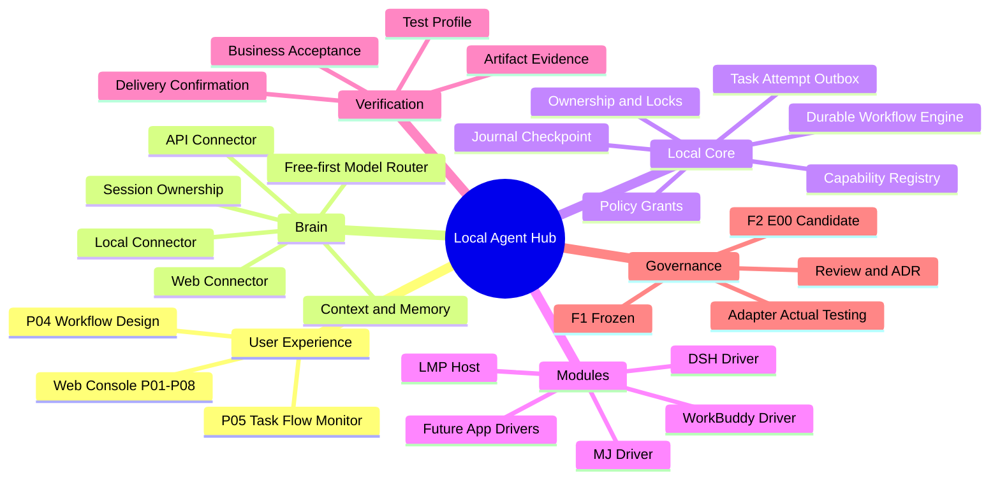
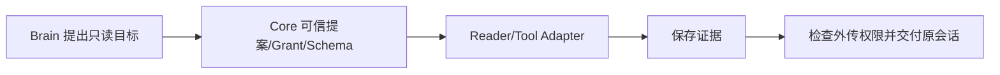
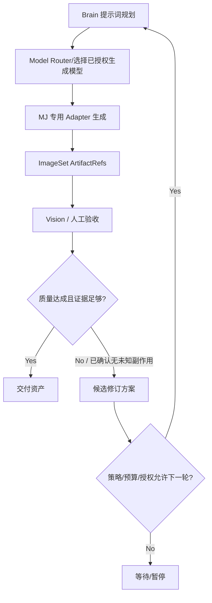
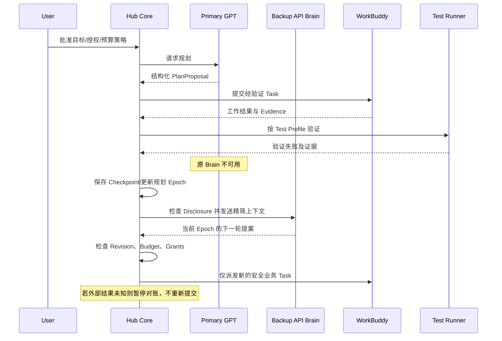

# ARCH-06-08｜系统脑图、任务链与示例

图为架构候选，非产品运行截图；示例不需要接触真实 App、账号或文件。

## 1. 架构脑图

## 2. 任务链 A：简单操作

## 3. 任务链 B：媒体生成与审查

## 4. 任务链 C：长期开发、主 Brain 失联

## 5. 最小产品演示“完成”标准

- 能够区分 Proposal/Draft/Published Revision/Run，不以 GPT 文本触发未经授权的操作。
- 能显示明确绑定的模块能力、Connection、Session 和模型状态；未知状态不冒充 READY。
- 简单任务和线性流程经过同一 Core 权威 Task、Attempt、Journal。
- 运行结果有独立 Execution、Storage、Delivery、Verification 证据。
- 浏览器断线后，P05 能通过 Snapshot + journalSeq 展示可核实的最后状态。
- 结果未知、权限撤销、人工接管时有正确 Block/Approval/Recovery 体验。
- 以上均仅在对应测试真实通过后才能标记 PASS，未实现前只可演示 Mock。
