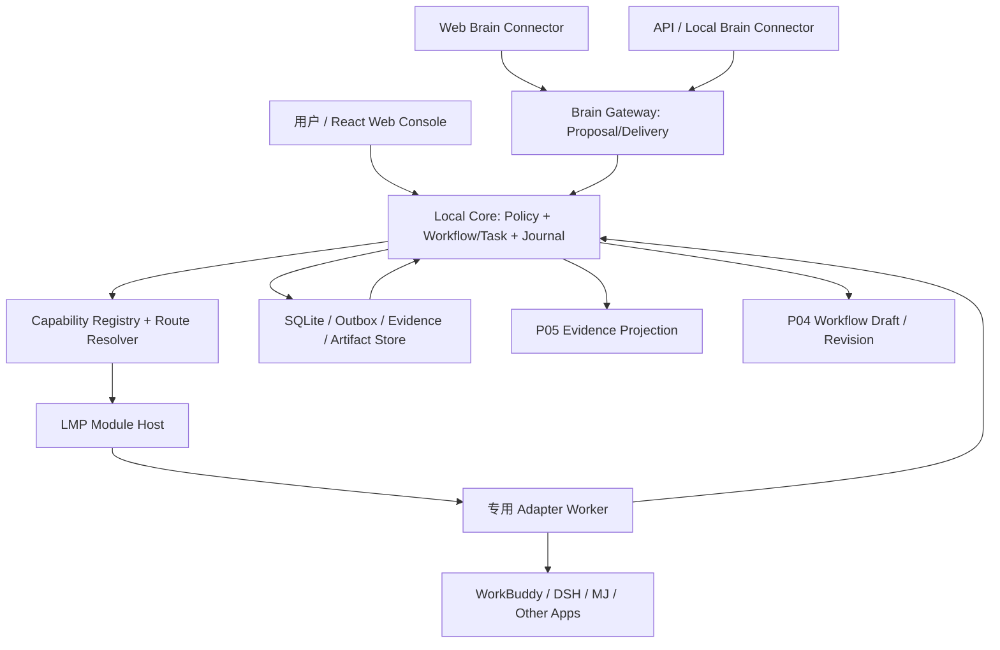

# ARCH-07-01｜最终架构与产品范围裁决 V0.3

**状态：技术方案裁决建议（`ARCH07_RECOMMENDED`），待用户正式批准；不是 F2 冻结或实现许可。**

## 1. 结论

不重建、不移植 Relay、不更改已经冻结的 F1 12 条不变量。Local Agent Hub 采用**模块化单体 Local Core + 统一 LMP + 独立受管 Adapter Worker + 可替换 Brain Connector + SQLite Journal/Artifact Store + 响应式 Web Console**。

工程按 **底座验证 → 真实闭环 → 可扩展产品 V1 → 高级自主编排 V1.x** 分层推进。保留最终支持 GPT 自由编排、多模型选择、自由画布、MJ/视频/音频、持久化记忆、长期无人值守的目标，但不让这些高级能力阻塞首条可靠业务链路。

## 2. 权威结构和通信边界

- **Core**：唯一受管任务、授权、所有权、持久化事件、恢复决定与派发权威。Brain、Adapter、UI 不得绕过。
- **Brain Gateway**：认证 Brain Connector、接收结构化任务候选、投递验证过的上下文及结果；**不是第二个 Scheduler**。
- **LMP**：Core 与 Module Host/Adapter 的协议。`TaskProposal` 是 Brain 业务入口对象，**不替代** LMP Envelope。
- **Adapter**：逐 App 专门实现身份定位、会话、操作和真实证据收集；不得把不同 App 假定为同一 GUI。
- **Relay**：独立开发辅助工具，不移入新产品、不接管其正式运行时状态。

## 3. 裁决台账

| ID | 裁决 | 来源/级别 | 工程后果 |
|---|---|---|---|
| D07-01 | F1 12 条不变量保持冻结 | FROZEN_F1 | 新增架构必须兼容；如需更改先 ADR |
| D07-02 | 只有一个 Local Core 权威 | FROZEN_F1 / ARCH07_RECOMMENDED | 不另建 Brain Scheduler/Relay 调度器 |
| D07-03 | Windows 单用户、本机 Web Console | USER_DIRECTION_CONFIRMED | V1 无云账户或多用户权限系统 |
| D07-04 | LMP + Manifest + Capability Descriptor + Adapter Worker | 既有 F2 候选 | E00 之前不冻结字段；Core 不包含 App 专属分支 |
| D07-05 | 模块安装先内置 + 用户信任的本地开发者模块 | USER_DIRECTION_CONFIRMED | 插件市场延期 |
| D07-06 | Reader、受控 Test、Web Brain、WorkBuddy GUI、结果回传为 V1 基础能力 | 既有 V1.1 PRD / ARCH07_RECOMMENDED | 必须按 Gate 给证据，不因 GUI 弱而谎称可无人值守 |
| D07-07 | 用 Workspace Reader 允许网页 Brain 受控查询本机文件 | 既有 P0 需求 | `LOCAL_READ` 与 `EXTERNAL_DISCLOSURE` 分别验证 |
| D07-08 | 工作流先线性/步骤式 Draft + 不可变 Revision + 监控，再自由画布 | ARCH07_RECOMMENDED | P04 先保留步骤和关系视图，复杂 Canvas V1.x |
| D07-09 | P04/P05 共用权威节点/Run 身份，P05 仅投影真实事实 | F1 对齐 | UI 不得将点击/ACK/验收混淆 |
| D07-10 | Brain 提交经过认证的结构化候选，不靠 `USE:` 字样授权 | F1-05 推导 | Core 验证来源、Schema、Grant、去重 |
| D07-11 | FREE_FIRST 仅在授权模型池和真实能力可用范围内生效 | USER_DIRECTION_CONFIRMED | 免费优先路由 V1.x，记录实际选择证据 |
| D07-12 | 主 Brain 失联选已授权 API 备用；仅安全检查点自动切回 | USER_DIRECTION_CONFIRMED | Brain Ownership 与上下文交接 V1.x 实测后开放 |
| D07-13 | 不预设固定最大总迭代数，但必须有预算、停滞、授权和副作用守卫 | USER_DIRECTION_CONFIRMED | 长期自主 Iteration V1.x，不能无预算盲循环 |
| D07-14 | 结果未知先对账，不能因换 Brain/模型/执行器重试副作用 | FROZEN_F1 | Attempt 与 DeliveryAttempt/Iteration 分离 |
| D07-15 | SQLite + 受控 Artifact Store，先基础 Journal 与恢复，再记忆索引 | ARCH07_RECOMMENDED | 不要求向量数据库/云队列 |
| D07-16 | 首个真实闭环验证后，再扩展 DSH、MJ 等专用 Adapter | ARCH07_RECOMMENDED | 不预先承诺 MJ 非公开接口和模型能力 |
| D07-17 | Webflow 继续承担已存在的 UI 原型，实际 Web Console 候选用 React/TS/Vite | ARCH07_RECOMMENDED | 不覆盖现有 DS08 和 `docs/ui-design/` |
| D07-18 | Git 与文档状态分层；ARCH-07 不等同开工授权 | ARCH07_RECOMMENDED | 单独用户审批 E00、真实 App 与 COD/UI 交接 |

## 4. MVP 范围的正式建议

### P0：可以判定为可用 V1 的必要功能

- Windows 本地 Launcher 启停 Core，正确诊断不能启动及断线情况；有真实 Web Console。
- 经过授权的 Workspace Reader：目录/搜索/分段读取/版本与路径边界；可经许可回到原网页 Brain 会话。
- Module Registry、Manifest 审查、Capability/版本发现、可信内置/开发者模块管理。
- 一个可验证的网页 Brain Connector，至少在**申明的能力等级**内实现会话绑定和请求/结果匹配；不把原生工具模式与普通网页会话桥接混同。
- 一个真实 WorkBuddy GUI Adapter，符合获准的会话/操作等级；必须说明 G0/G1/G2/G3。
- 第二个真实、不同驱动路径的 Adapter（优先 DSH ACP；若不可用需做范围 ADR，不能用纯 Mock 冒充真实兼容性通过）。
- Task、Attempt、事件、Outbox/Inbox、Artifact、Run、Evidence、Delivery/Verification 分层持久化。
- LOCAL_READ、EXTERNAL_DISCLOSURE、LOCAL_EXECUTE 三轴授权、Session Ownership、人工接管显式恢复、未知效果对账。
- 注册的 Test Profile 运行及真实业务验证；不默认提供任意 Shell。
- P02 基础连接管理、P04 有限工作流配置、P05 证据监控、P06 审批恢复及相关基础页面。
- 核心崩溃/重启恢复、安装/更新/诊断流程和安全失败体验。

### 第一条端到端业务链（受控样板）

`Web Brain 经认证提交候选 → Core 确认当前许可 → WorkBuddy GUI 执行隔离样板任务 → Test Runner 验证真实产物 → Journal 持久化 → 原 Brain 会话收到经过核验的结果 → P05 展示状态与证据`。

Reader 独立链路：`Web Brain → Core/Reader → 内容来源与授权 → 单独核验 Disclosure → 原 Web Brain`。

### V1.x：预留结构，但延期实现

自动免费优先 Model Catalog/Router、API Brain 故障切换与安全切回、持久化跨模型记忆、动态 Plan/不设固定总轮数的 Iteration、自主停滞处理、完整可拖动节点画布、MJ/视频/音频、子工作流、批处理、并行、多项目、可选定时任务。

*产品定位补充*：V1 不等于 G3 完整无人值守；允许声明“受监督自动化”。但若 E02 无法可靠自动收发或 E03 仅能 G0，则第一条目标闭环尚未达标。可以交付明确限制的 Alpha，不得宣布目标 V1 完成或偷偷降低 P0。修改 P0 范围必须走新需求裁决与批准。

## 5. 技术路线选择

| 部分 | 推荐默认 | 需要进一步验证 |
|---|---|---|
| Core | Node.js LTS + TypeScript 模块化单体 | Windows 8GB 环境、事务/稳定性及依赖版本 |
| 数据库 | SQLite，事务型 Journal/Outbox/Inbox | 恢复语义、备份/迁移、WAL 适用性 |
| Artifact | 受控本地文件与摘要/ACL/来源索引 | 文件生命周期与隐私、损坏检测 |
| 协议 | LMP，UTF-8 JSON + JSON Schema 2020-12 | E00/F2 冻结 |
| Worker IPC | 已认证本机 IPC（Named Pipe/stdio/WS 候选） | 身份、重连、错误与资源压力测试 |
| Adapter SDK | TypeScript 优先、语言中立 | 非 TS Driver 的真实兼容性 |
| WorkBuddy | Windows UIA 等专用 GUI Driver（必要时其他语言桥接） | GUI 会话、焦点、缩放与真实终态 |
| Browser | Native Tool 优先，逐站扩展/Bridge 条件支持 | 来源鉴权、轮次和投递确认、平台允许的能力 |
| Web Console | React + TypeScript + Vite | P01–P08 与现有 Webflow 原型对齐 |
| 图形编辑 | 兼容 React 的节点图组件（React Flow 等仅是候选） | 前提是 Graph Schema/Revision 已经稳定 |
| Memory | SQLite/全文索引 + 结构化摘要 + 证据引用 | 无向量 DB 的首版也可运行 |
| Credential | Windows 用户保护机制 + 最小权限 | 恢复、凭据不入日志和模型上下文 |
| Launcher | 轻量 Windows 本机启动器 | 安装器与更新/回退方式后置 |

不使用 Relay 代码、数据库和 Task Queue 作为 Hub 核心依赖；不得把独立 Worker 描述成强 OS 沙箱；不承诺外部 GUI 完全 exactly-once。

## 6. 四层建设模型与发布门槛

1. **L0 底座**：F1 基线、E00 Mock 全 31 项和独立批准 F2。
2. **L1 真实闭环**：E01 Reader、E02 网页、E03 GUI、E05 Test 的分级证据，至少两条目标路径可跟踪验证。
3. **L2 产品 V1**：E04 第二驱动、E06 真实恢复、E07 Launcher/Web Console、模块维护与诊断，用户批准发布。
4. **L3 高级自治 V1.x**：Model Router、Brain Failover、Memory、Dynamic Plan/Iteration、Canvas、媒体 Adapter 分功能开启，每个独立新 Gate。

E01–E05 的实施探索可以交错，但 E00 是对有副作用真实自动化的前置要求；E06/E07 是 V1 正式交付的必要门槛。凡被动演示未达级别，不能标注为全自动。

## 7. 初步产品完成定义（V1 DoD）

- 真实 Windows 环境中能安装、启动、连接、工作、关闭和重启。
- 用户不修改数据库/写入任意调试脚本，也能经控制台配置测试用的可信模块及授权工作区。
- Reader 受控查询可用，外传需独立检查并保持正确会话归属。
- 样板任务能从已认证来源进入 Core，获得授权，在 WorkBuddy 执行并经独立验证。
- 一条不同驱动形态的 Adapter 能复用同样的能力契约；不为它修改 Core App 专有分支。
- 每一阶段从接受、外部提交、结果存储、交付，到业务验收都有可追溯证据；不能用 ACK 宣称成功。
- 故障、重复、接管、撤销授权、未知副作用、错会话的安全用例有可复核证据，出现 P0 安全违例即失败。
- E00–E07 相应必需门禁通过，未支持的能力明确降级；正式版本有用户批准及回退计划。

## 8. 现时事实与立即暂停点

- `main@d666bfc8f3fea570871d6f51d7215881f325aa7c` 的 F1 冻结是历史确认；在此轮未执行远程写入。
- 本地分支 `docs/arch-06-review@bc6bac0` 已由用户终端记录；这不是自动表示已推送、PR 或合并。
- `docs/ui-design/` 未追踪，不作为本轮提交流程的输入。
- F2 为 Candidate、E00 原 31 caseId = NOT_RUN、E01–E07 未验收；ARCH-06/07 均非真实功能实现。
- 本轮任何文档不授予 COD/UI 开工、网页写入、真实本机代码执行、云 API 消费或项目数据外传许可。
